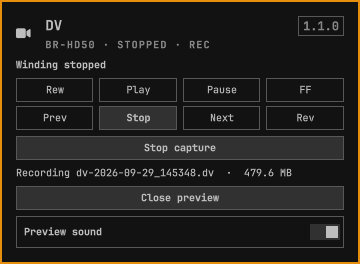

# DV

Bar widget for a FireWire DV deck.

Click the camera icon for rewind, play, pause, fast forward, frame step, and reverse. Live preview opens a window on the incoming DV stream without starting the tape. Press play when you want the deck to roll. Capture saves that same stream as a raw DV file in `~/Videos` and leaves the preview up. Right-click the icon to open or close the window. Closing the window does not stop a capture. Preview sound stays off until you turn it on, so the deck and the window do not both play the same audio.

The preview listens only. It does not press play or stop on the deck.



## Install

```sh
omarchy plugin add https://github.com/wouldja/omarchy-dv.git --enable
```

The widget lands on the right of the bar. If it does not appear immediately:

```sh
omarchy-shell shell rescanPlugins
```

It needs a FireWire DV device the kernel has already enumerated, plus `dvgrab`, `dvcont` (from `libavc1394`), and `mpv`.

## Remove

```sh
omarchy plugin remove io.github.wouldja.dv
```

That drops the widget. Captures already saved in `~/Videos` stay there.

## License and dependencies

MIT. See [LICENSE](LICENSE).

Needs Omarchy (Quickshell), Python 3, dvgrab, dvcont, and mpv. No network calls.
